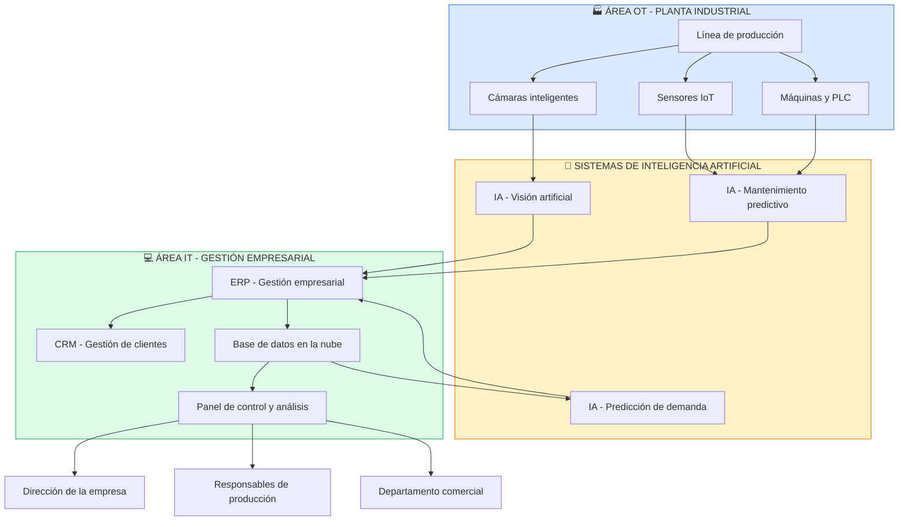

# Proyecto 1: Diseño de la transformación digital de un sector usando IA

> **Módulo:** Digitalización aplicada a los sectores productivos  
> **Proyecto:** Diseño de la transformación digital de un sector usando Inteligencia Artificial  
> **Sector:** Industria agroalimentaria – Conservas de pescado  
> **Empresa:** Conservas Bahía de Cádiz S.L. (empresa ficticia)  
> **Curso:** 1º DAW-A

---

## 1. Introducción

La transformación digital consiste en incorporar tecnologías digitales a los procesos de una empresa para mejorar su productividad, eficiencia y competitividad.

Actualmente, las empresas necesitan adaptarse a los avances tecnológicos para poder competir en un mercado cada vez más exigente. Una de las tecnologías más importantes es la Inteligencia Artificial (IA), que permite analizar grandes cantidades de datos, automatizar tareas, detectar errores y ayudar en la toma de decisiones.

En este proyecto se propone un plan de transformación digital para una empresa ficticia del sector agroalimentario situada en Cádiz: **Conservas Bahía de Cádiz S.L.**

El objetivo es modernizar tanto sus procesos industriales (digitalización en planta u OT) como sus procesos administrativos y comerciales (digitalización en negocio o IT), utilizando distintas tecnologías de Inteligencia Artificial.

## 2. Ficha de la empresa

### 2.1. Datos generales

| Característica | Descripción |
|---|---|
| Nombre | Conservas Bahía de Cádiz S.L. |
| Ubicación | Cádiz, Andalucía, España |
| Sector | Industria agroalimentaria |
| Actividad | Elaboración y envasado de conservas de pescado |
| Tamaño | Pequeña y mediana empresa (PYME) |
| Empleados | 45 trabajadores |
| Clientes | Supermercados, restaurantes y distribuidores |
| Productos | Conservas de atún, melva, caballa y sardinas |

### 2.2. Situación actual

La empresa utiliza maquinaria industrial para limpiar, cocinar, enlatar, etiquetar y empaquetar los productos.

Sin embargo, todavía presenta algunos problemas relacionados con la falta de digitalización:

- Parte del control de producción se realiza manualmente.
- La detección de defectos depende de inspecciones visuales de los trabajadores.
- No existe un sistema avanzado para predecir averías en las máquinas.
- La gestión del inventario se realiza mediante hojas de cálculo.
- Los pedidos y las facturas se gestionan con diferentes programas.
- La información de producción y administración no está completamente integrada.

Estos problemas provocan pérdidas de tiempo, posibles errores humanos, gastos innecesarios y dificultades para tomar decisiones.

Por ello, la empresa necesita desarrollar un proceso de transformación digital.

## 3. Fundamentos teóricos: digitalización en planta y en negocio

La digitalización empresarial se puede dividir en dos grandes áreas:

### 3.1. Digitalización en planta (OT)

La digitalización en planta está relacionada con los procesos industriales y productivos.

Su finalidad es mejorar la fabricación, controlar las máquinas y aumentar la calidad de los productos.

En nuestra empresa se aplicaría mediante:

- Sensores inteligentes para controlar la temperatura y presión de las máquinas.
- Cámaras con Inteligencia Artificial para detectar defectos en las latas.
- Sistemas de mantenimiento predictivo para anticipar averías.
- Monitorización automática de las líneas de producción.

### 3.2. Digitalización en negocio (IT)

La digitalización en negocio está relacionada con la administración, gestión y organización de la empresa.

Su finalidad es mejorar la comunicación, la gestión económica y la relación con los clientes.

En nuestra empresa se aplicaría mediante:

- Sistemas ERP para gestionar compras, ventas, almacenes y contabilidad.
- Sistemas CRM para gestionar clientes y pedidos.
- Inteligencia Artificial para predecir la demanda.
- Almacenamiento de información en la nube.

### 3.3. Diferencias entre IT y OT

| Aspecto | IT (Tecnologías de la información) | OT (Tecnologías operacionales) |
|---|---|---|
| Función | Gestionar información | Controlar procesos industriales |
| Ámbito | Oficinas y administración | Fábrica y producción |
| Tecnologías | ERP, CRM, nube e IA | Sensores, PLC, cámaras y robots |
| Objetivo | Mejorar la gestión | Mejorar la fabricación |
| Ejemplo | Control de inventario | Control automático de temperatura |

La integración de IT y OT permite que los datos de fabricación lleguen directamente a los sistemas de gestión, consiguiendo una empresa conectada de principio a fin.

## 4. Tecnologías de digitalización propuestas

Se proponen cinco tecnologías para modernizar la empresa.

### 4.1. Inteligencia Artificial y visión artificial

**Aplicación:** Digitalización en planta (OT).

Se instalarán cámaras inteligentes en las líneas de envasado para analizar automáticamente las latas.

La IA permitirá detectar:

- Envases deformados.
- Etiquetas mal colocadas.
- Latas mal cerradas.
- Errores de etiquetado.
- Defectos visibles en los productos.

**Ventajas:**

- Mejora el control de calidad.
- Reduce los errores humanos.
- Aumenta la velocidad de inspección.
- Disminuye los productos defectuosos.

### 4.2. Internet de las Cosas (IoT)

**Aplicación:** Digitalización en planta (OT).

Se instalarán sensores conectados a Internet en las máquinas de producción.

Estos sensores recogerán información sobre:

- Temperatura.
- Presión.
- Humedad.
- Vibraciones.
- Consumo energético.

Los datos se enviarán a una plataforma central para poder controlar el estado de las máquinas en tiempo real.

**Ventajas:**

- Control continuo de la producción.
- Detección temprana de anomalías.
- Mayor eficiencia energética.
- Mejor control de las condiciones de fabricación.

### 4.3. Mantenimiento predictivo mediante IA

**Aplicación:** Digitalización en planta (OT).

Se utilizarán algoritmos de Inteligencia Artificial que analizarán los datos de los sensores para identificar patrones que indiquen posibles averías.

Por ejemplo, si una máquina comienza a vibrar más de lo habitual, el sistema podrá detectar que existe un posible problema antes de que se produzca una avería.

**Ventajas:**

- Reduce las paradas inesperadas.
- Disminuye los gastos de reparación.
- Aumenta la vida útil de la maquinaria.
- Permite organizar mejor las tareas de mantenimiento.

### 4.4. Sistema ERP y CRM

**Aplicación:** Digitalización en negocio (IT).

Se implantará un sistema ERP para centralizar la información de la empresa y un CRM para gestionar las relaciones con los clientes.

El ERP permitirá gestionar:

- Compras de materias primas.
- Inventario y almacenes.
- Ventas y facturación.
- Contabilidad.
- Planificación de la producción.

El CRM permitirá:

- Registrar clientes.
- Gestionar pedidos.
- Consultar el historial de compras.
- Mejorar la atención al cliente.

**Ventajas:**

- Centralización de la información.
- Menos errores administrativos.
- Mayor control económico.
- Mejor comunicación entre departamentos.

### 4.5. Inteligencia Artificial para la predicción de la demanda

**Aplicación:** Digitalización en negocio (IT).

Se utilizará un sistema de IA que analizará las ventas anteriores, la temporada del año, los pedidos y las tendencias de consumo.

Con esta información podrá estimar cuántas conservas necesitará producir la empresa.

Por ejemplo, si el sistema detecta que durante el verano aumenta la demanda de determinados productos, recomendará incrementar su producción y preparar el inventario con antelación.

**Ventajas:**

- Evita producir cantidades innecesarias.
- Reduce el exceso de inventario.
- Mejora la planificación.
- Ayuda a evitar la falta de productos.
- Reduce costes de almacenamiento.

## 5. Diagrama de arquitectura IT/OT con Mermaid

El siguiente diagrama representa cómo se conectan los sistemas de producción (OT) con los sistemas de información (IT), mostrando la participación de la Inteligencia Artificial en los procesos de la empresa.

### Explicación del diagrama

El funcionamiento sería el siguiente:

1. Los sensores IoT y las máquinas recogen información durante la fabricación.
2. Las cámaras inteligentes envían imágenes al sistema de visión artificial.
3. La IA analiza las imágenes y detecta posibles defectos.
4. Los sensores proporcionan información al sistema de mantenimiento predictivo.
5. Los datos de producción se envían al ERP para integrarlos con la información empresarial.
6. El sistema de predicción de demanda analiza las ventas y recomienda las cantidades que deben fabricarse.
7. Los responsables de la empresa consultan los resultados mediante un panel de control.

De esta manera, IT y OT trabajan conjuntamente y permiten gestionar la empresa de forma integrada.

## 6. Propuesta de transformación digital

La transformación digital se desarrollará en diferentes fases para evitar problemas durante la implantación.

### Fase 1. Análisis de la situación actual

Se estudiarán los procesos de producción y administración para identificar los principales problemas.

Se analizarán las máquinas, los programas utilizados y las necesidades de los trabajadores.

### Fase 2. Instalación de sensores y sistemas IoT

Se instalarán sensores en las máquinas para recoger información sobre su funcionamiento.

También se conectarán los dispositivos a una plataforma centralizada para visualizar los datos.

### Fase 3. Implantación de Inteligencia Artificial

Se introducirán sistemas de visión artificial para detectar defectos en los productos y algoritmos de mantenimiento predictivo para anticipar posibles averías.

También se desarrollará un sistema de predicción de la demanda.

### Fase 4. Digitalización del negocio

Se implantará un sistema ERP y CRM para centralizar la gestión de la empresa.

De esta forma, los departamentos de producción, administración, compras y ventas podrán compartir información.

### Fase 5. Formación de los trabajadores

Se impartirán cursos para que los empleados aprendan a utilizar las nuevas herramientas digitales.

La formación incluirá:

- Manejo de los nuevos programas.
- Interpretación de los datos.
- Uso de sistemas de IA.
- Ciberseguridad.
- Buenas prácticas digitales.

### Fase 6. Evaluación de resultados

Se analizará si las tecnologías implantadas están cumpliendo los objetivos.

Se tendrán en cuenta indicadores como:

| Indicador | Objetivo propuesto |
|---|---|
| Productos defectuosos | Reducir un 30 % |
| Paradas inesperadas | Reducir un 25 % |
| Tiempo de gestión de pedidos | Reducir un 20 % |
| Exceso de inventario | Reducir un 15 % |
| Consumo energético | Reducir un 10 % |

*Nota: Los porcentajes son objetivos estimados para el proyecto, no resultados reales de una implantación.*

## 7. Ventajas de la transformación digital de extremo a extremo

La integración de todas estas tecnologías permitirá mejorar el funcionamiento general de la empresa.

### 7.1. Ventajas operativas

- Mayor velocidad en los procesos de fabricación.
- Reducción de errores y productos defectuosos.
- Mejor control de las máquinas.
- Menos averías inesperadas.
- Optimización del consumo energético.
- Mejor organización del inventario.
- Mayor coordinación entre departamentos.

### 7.2. Ventajas económicas

- Reducción de gastos de mantenimiento.
- Menor desperdicio de materias primas.
- Disminución de pérdidas económicas.
- Mejor planificación de las compras.
- Mayor aprovechamiento de los recursos disponibles.

### 7.3. Ventajas competitivas

La transformación digital permitirá a Conservas Bahía de Cádiz diferenciarse de otras empresas del sector.

Podrá ofrecer productos con mayor calidad, responder más rápidamente a los pedidos y adaptarse mejor a las necesidades de sus clientes.

Además, la empresa tendrá más facilidad para crecer y competir en nuevos mercados.

### 7.4. Ventajas para el sector agroalimentario

La incorporación de IA y otras tecnologías digitales también puede beneficiar al conjunto del sector:

- Mejora de la seguridad alimentaria.
- Mayor trazabilidad de los productos.
- Reducción del desperdicio alimentario.
- Optimización de los recursos naturales.
- Mejora de la productividad industrial.

## 8. Impacto de la Inteligencia Artificial en otros sectores

La IA no solamente se utiliza en la industria agroalimentaria. También tiene aplicaciones importantes en muchos otros sectores.

| Sector | Aplicación de la IA | Beneficios |
|---|---|---|
| Sanidad | Análisis de imágenes médicas y apoyo al diagnóstico | Mayor rapidez y precisión |
| Agricultura | Agricultura de precisión y detección de enfermedades | Optimización de cultivos |
| Industria | Mantenimiento predictivo y control de calidad | Mayor productividad |
| Transporte | Optimización de rutas y conducción automatizada | Ahorro de tiempo y combustible |
| Finanzas | Detección de fraudes y análisis de riesgos | Mayor seguridad |
| Comercio | Recomendaciones personalizadas y predicción de ventas | Mejora de las ventas |

### Comparación con nuestro sector

La industria agroalimentaria comparte muchas aplicaciones con otros sectores industriales.

Por ejemplo, al igual que en la industria del automóvil, se puede utilizar la IA para detectar defectos en los productos y anticipar averías en las máquinas.

También comparte aplicaciones con la agricultura, ya que ambas actividades pueden utilizar sistemas inteligentes para optimizar recursos y mejorar la planificación.

Sin embargo, en el sector de las conservas de pescado existe una necesidad especialmente importante de garantizar la calidad, la higiene, la seguridad alimentaria y la trazabilidad de los productos.

Por ello, la visión artificial, los sensores y el análisis de datos tienen un papel fundamental.

## 9. Importancia presente y futura de la Inteligencia Artificial

### 9.1. Importancia actual

Actualmente, la Inteligencia Artificial está adquiriendo una gran importancia en el mundo empresarial.

En la industria manufacturera permite mejorar los controles de calidad, anticipar averías y optimizar los procesos de producción.

En el sector agroalimentario puede ayudar a controlar las condiciones de fabricación, reducir los desperdicios y mejorar la planificación de las empresas.

Según la OCDE, entre las aplicaciones industriales de mayor impacto se encuentran el mantenimiento predictivo, el control de calidad y la optimización de las cadenas de suministro.

### 9.2. Perspectiva de futuro

En los próximos años, la IA tendrá un papel todavía más importante en la industria.

Es posible que las fábricas incorporen sistemas cada vez más autónomos, robots inteligentes y herramientas capaces de tomar decisiones a partir de grandes cantidades de datos.

En el sector de las conservas de pescado, estas tecnologías podrían permitir líneas de producción más automatizadas, controles de calidad en tiempo real y una trazabilidad mucho más precisa.

También podrían desarrollarse sistemas capaces de ajustar automáticamente los procesos de fabricación para reducir el consumo energético y los desperdicios.

No obstante, será necesario garantizar la seguridad de los sistemas, proteger los datos y mantener la supervisión humana en las decisiones importantes.

## 10. Reflexión final

Después de realizar este proyecto, considero que la transformación digital y la Inteligencia Artificial son fundamentales para el futuro de las empresas.

La tecnología permite mejorar los procesos de fabricación, reducir costes, evitar errores y facilitar la toma de decisiones.

En el caso de Conservas Bahía de Cádiz, la combinación de sensores IoT, visión artificial, mantenimiento predictivo y sistemas de gestión empresarial permitiría transformar una empresa tradicional en una industria más moderna, eficiente y competitiva.

También considero que la IA no debe entenderse como un sustituto completo de los trabajadores, sino como una herramienta que facilita sus tareas y mejora sus capacidades.

En conclusión, las empresas que sepan adaptarse a los avances tecnológicos tendrán mayores oportunidades de crecimiento y podrán responder mejor a los retos del futuro.

## 11. Conclusiones

Con este proyecto hemos comprobado que la digitalización debe abarcar todas las áreas de una empresa.

No basta con automatizar las máquinas de una fábrica: también es necesario mejorar la administración, la gestión de clientes, el almacenamiento de información y la planificación de la producción.

La integración de IT y OT permite conectar todos estos procesos y aprovechar mejor la información generada.

La Inteligencia Artificial representa una oportunidad importante para el sector agroalimentario, ya que permite mejorar la calidad, reducir costes y aumentar la competitividad.

Por tanto, la transformación digital es una inversión estratégica para garantizar el crecimiento y la adaptación de las empresas a las nuevas necesidades del mercado.

## 12. Fuentes de información y bibliografía

- [IES Rafael Alberti - Proyecto 1: Diseño de la transformación digital de un sector usando IA](https://ies-rafael-alberti.github.io/digitalizacion-gs/docs/proyectos/proyecto1/)
- [OCDE - Progress in Implementing the European Union Coordinated Plan on Artificial Intelligence (2025)](https://www.oecd.org/en/publications/progress-in-implementing-the-european-union-coordinated-plan-on-artificial-intelligence-volume-2_3ac96d41-en.html)
- [OCDE - Artificial Intelligence in Society](https://www.oecd.org/en/publications/artificial-intelligence-in-society_eedfee77-en.html)
- [Mermaid - Documentación oficial](https://mermaid.js.org/)
- [Unión Europea - Eurostat](https://ec.europa.eu/eurostat)

---

**Proyecto realizado para el módulo de Digitalización aplicada a los sectores productivos.**

*Empresa ficticia creada con fines educativos. Los datos y objetivos de mejora son hipotéticos.*
